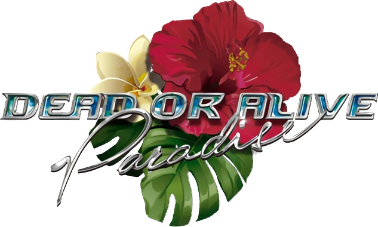

  

# DOAP-Enhanced

A patcher for **Dead or Alive Paradise** (PSP) that runs the game at a true
60 FPS at the original game speed, and replaces the lower poly girl models with
the higher poly models from the game's cutscenes. You run it on your own ISO and
it writes a new, patched ISO to play in the
[PPSSPP](https://www.ppsspp.org/) emulator.

> [!WARNING]
> **You must raise PPSSPP's emulated CPU clock to 444 MHz or higher.** High poly
> models are used everywhere in the game, including all the places that
> originally used lower poly ones. At the default clock, volleyball drops to
> 30 FPS and runs at half speed. See [Playing](#playing).
>
> This build is for the PPSSPP emulator only. PSP hardware is unsupported and
> untested.

> **This repository and its releases do not contain the game.** No game code,
> data, audio or video is included. You need your own copy of Dead or Alive
> Paradise for the PSP. The patcher stores only the differences between game
> versions, which are useless without your own ISO.
> Please do not share or link to game files or patched ISOs in issues or pull
> requests. The patcher's background, the icon and the logo on this page show a
> Dead or Alive character and the game's logo, which belong to Koei Tecmo and
> are not covered by this project's license.
>
> Not affiliated with or endorsed by Koei Tecmo, Team NINJA or Sony. All
> trademarks belong to their respective owners.

Current version: **1.0.2** (see [CHANGELOG.md](CHANGELOG.md)).

## Supported game version

Only the USA release is supported, clean or patched by this project:

| | |
|---|---|
| Game ID | `ULUS-10521` |
| Region | USA (En, Ja, Fr, De) |
| ISO size | 869,990,400 bytes |
| ISO SHA-256 | `b70b13194790e1f078386204b460df5d484177cdb974d2f7fdff6b38afe50476` |
| Patched ISO SHA-256 | `ca2dec7a3b35f25a71bfb188640c06b90d629831db33c93416859b17f98b8ca7` |

The patcher detects which ISO you give it before it changes anything:

| Your ISO | What the patcher does |
|---|---|
| Clean | Applies the full patch |
| Patched with v1.0.0 or v1.0.1 | Updates it to the latest version, so you don't need to keep a clean ISO |
| Already the latest version | Leaves it alone |
| Anything else | Refuses it |

A dump with a different full-disc hash can still be patched, as long as it is the
right size and every byte the patch touches matches a known version. Other
regions are refused.

## What it changes

- **True 60 FPS game wide**, with girl animation, body physics and camera pans
  all running at 60 FPS, including minigame intros, win poses and relax scenes.
- **Original game speed** kept in volleyball, Pool Hopping, relax scenes and the
  casino.
- **Higher poly models everywhere.** Every place the game used lower poly models
  of the girls now uses the models from the cutscenes, bringing it closer to
  Dead or Alive Xtreme 2. There is no option to keep the lower poly models.
- **Casino payouts are 10x** (experimental) in blackjack, poker and slots, and
  the amounts shown on screen match what you receive. Blackjack pushes and
  returned half bets still pay back the original amount.

Minigames are fixed but still need testing. Please report anything that looks
or feels off.

## Known issues

- **Menus run at double speed.** Fixing this needs a big rebuild of the menu
  code. It does not affect gameplay.

## Patching

1. Download `DOAP-Enhanced-Patcher-v<version>.exe` from the
   [Releases](../../releases) page.
2. Run it and press **BROWSE**, or drop your ISO on the window. It can be clean or
   already patched.
3. Press **PATCH**.

The new file, `Dead or Alive Paradise 60 FPS.iso`, is written next to the ISO you
chose, and needs about 900 MB of free space. The ISO you chose isn't changed,
unless it already has that name: then the patcher asks before replacing it. The
patcher checks the finished ISO against its expected SHA-256 when your source
exactly matches a known version.

The patcher is not code signed, so Windows SmartScreen may warn you the first
time you run it. Each release lists the file's SHA-256 in `SHA256SUMS.txt`.

## Playing

1. Open the patched ISO in PPSSPP.
2. Go to **Settings > System** and set **Change emulated PSP's CPU clock** to
   **444 MHz or higher**.
3. Keep PPSSPP's frame rate settings at their defaults.

Tested on PPSSPP v1.20.4 for Windows.

## Updating

From v1.0.2 on, the patcher can update itself:

1. Press **UPDATE**. It checks GitHub for the latest release and shows your
   version and the newest one.
2. If a newer version is available, press **INSTALL UPDATE**. Progress bars show
   each step: the download, a SHA-256 check against the release's
   `SHA256SUMS.txt`, and installing.
3. Press **RESTART PATCHER**, then choose your ISO and press **PATCH** to bring
   it up to date.

Updating replaces the patcher only. If the download fails its check, nothing is
changed. Versions before v1.0.2 have no **UPDATE** button, so download v1.0.2
from the [Releases](../../releases) page once.

## Network access

The only part of the patcher that goes online is the **UPDATE** page, and only
while you open it. It asks GitHub for the latest release, and **INSTALL UPDATE**
downloads it and checks its SHA-256 checksum. Patching itself works offline.
Nothing about you or your PC is sent.

## System requirements

- Windows 10 or 11 (64-bit) to run the patcher
- About 900 MB of free space on the drive holding your ISO
- PPSSPP with the emulated CPU clock at 444 MHz or higher

## Building from source

See [docs/BUILDING.md](docs/BUILDING.md). You need your own clean ISO, a
decrypted EBOOT dumped from it with PPSSPP, Python 3 and Visual Studio. Generated
files stay out of git.

## Repository layout

| Path | Contents |
|---|---|
| `patcher/` | The patcher: GUI and patching code (`doap_patcher.cpp`), updater (`doap_update.h`), payload builder (`build_payload.py`), build script and artwork |
| `tools/` | Patch builder (`build_patch.py`), small MIPS assembler (`mips.py`), high poly index rewrite (`hipoly.py`), ISO tools and EBOOT analysis helpers |
| `docs/` | Build guide and engineering notes from development |
| `release/` | Release notes |
| `scripts/` | Personal data and game file check, run before every push and release |

## License

The project's own code is BSD 3-Clause (see [LICENSE](LICENSE)); it covers only
material owned by the project's contributors and grants no rights to the game.
Third-party components keep their own licenses, listed in
[THIRD-PARTY-NOTICES.md](THIRD-PARTY-NOTICES.md).
